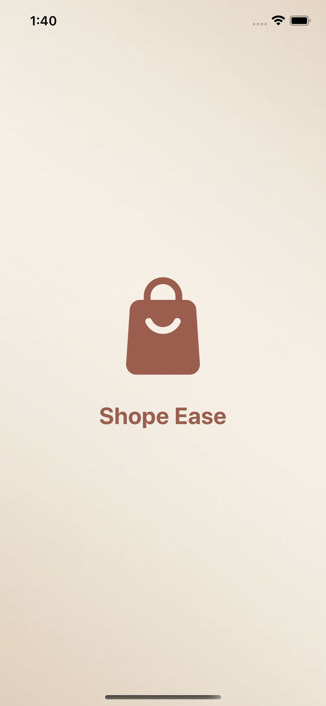
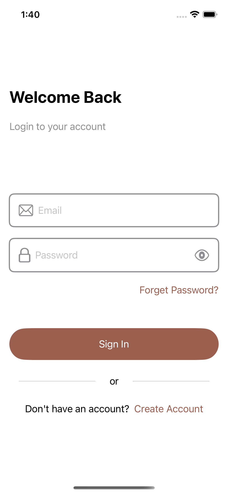
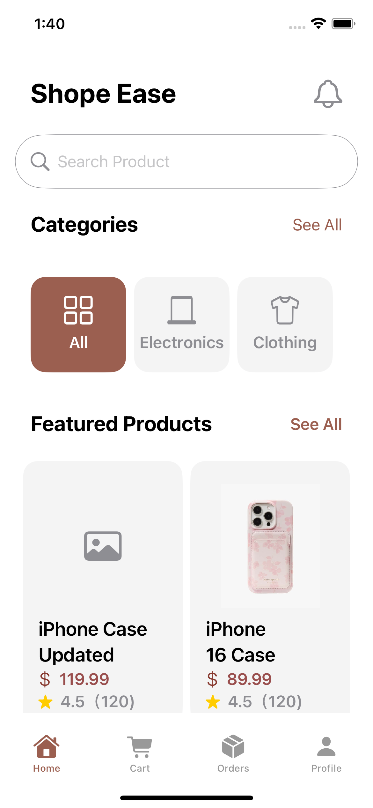
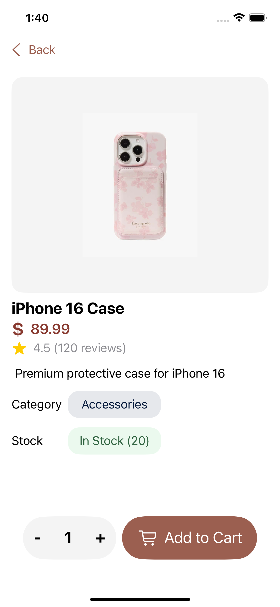
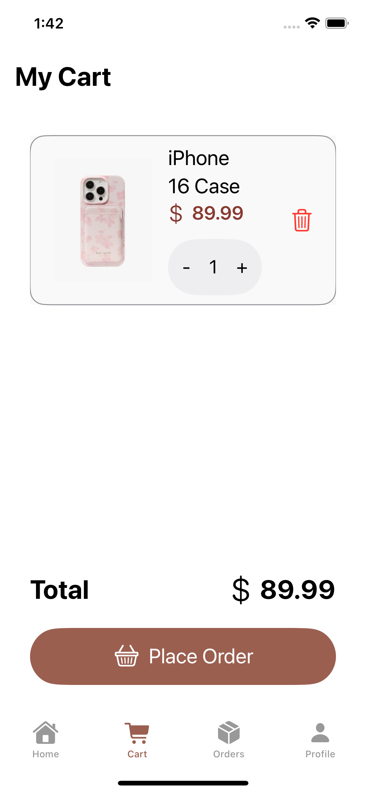
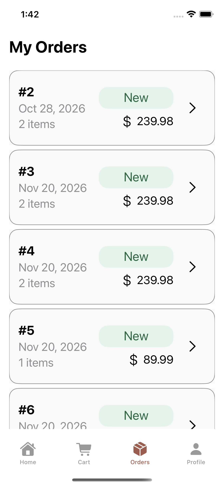

# 🛍️ Shope Ease – iOS E-Commerce App

A native iOS e-commerce application built using **Swift** and **SwiftUI**. Shope Ease provides users with a convenient shopping experience, allowing them to browse products, manage their shopping cart, place orders, and track their order history.

The application integrates with a RESTful backend API developed using **Java and Spring Boot**.

## 🚀 Features

- User registration and login.
- Browse products and categories.
- View detailed product information, prices, and stock availability.
- Add products to the shopping cart.
- Update product quantities and remove cart items.
- Place orders directly from the shopping cart.
- View order history and order details.
- Arabic and English language support.
- Right-to-left (RTL) layout support for Arabic.

## 📱 Screenshots

### Splash Screen


### Login Screen


### Home Screen


### Product Details


### Shopping Cart


### My Orders


## 🛠️ Tech Stack

- Swift
- SwiftUI
- Xcode
- MVVM Architecture
- RESTful API
- URLSession
- JSON
- Git & GitHub

## 🏗️ Architecture

The application follows the **Model-View-ViewModel (MVVM)** architectural pattern:

- **Views:** Build the user interface using SwiftUI.
- **ViewModels:** Manage application state and business logic.
- **Models:** Represent API data and application entities.
- **Services:** Handle API communication and network requests.

## 🌐 Backend Integration

The iOS application communicates with a RESTful backend API developed using Java and Spring Boot.

**Backend Repository:**  
[E-Commerce API – GitHub](https://github.com/ror2000/Ecommerce-API)

**Live API:**  
https://ecommerce-api-kvxq.onrender.com

The application uses HTTP requests to communicate with the backend, including authentication and retrieving and managing shopping data.

## 🌍 Localization

The application supports:

- English language.
- Arabic language.
- Right-to-left (RTL) layout direction for Arabic.
- Localized interface text using Apple's String Catalog.

Some API-provided content may still require additional localization improvements.

## ⚙️ Requirements

- macOS
- Xcode
- iOS Simulator or a compatible iPhone
- Access to the backend API

## ▶️ Getting Started

1. Clone the repository:

   ```bash
   git clone https://github.com/ror2000/Shope-Ease-iOS.git
   ```

2. Open `EcommerceApp.xcodeproj` in Xcode.

3. Select an iOS Simulator or connect a compatible iPhone.

4. Build and run the application.

## 🔮 Future Improvements

- Complete Arabic and English localization across all API content.
- Implement profile editing.
- Improve error handling and user feedback.
- Add unit and integration tests.
- Enhance application security.
- Improve the overall user experience.

## 👩‍💻 Author

**Rawan Amr**
